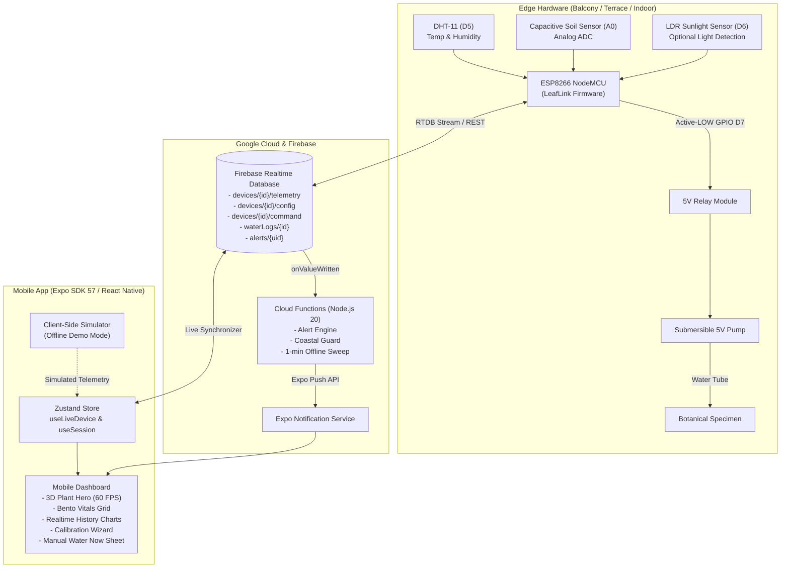

# LeafLink (Plant-Live) 🌿
> Smart Automated Plant-Watering & Microclimate Telemetry System
> Designed for Balconies, Terraces, and Indoor Gardens with Autonomous ESP8266 Edge Control and Realtime 3D Mobile Companion App.

---

## 📑 Table of Contents
1. [Architecture Overview](#1-architecture-overview)
2. [Key Features & Highlights](#2-key-features--highlights)
3. [Hardware Pin Map & Wiring](#3-hardware-pin-map--wiring)
4. [Quick Start & Local Setup](#4-quick-start--local-setup)
5. [Firebase & Cloud Functions Deployment](#5-firebase--cloud-functions-deployment)
6. [Database Seed Script](#6-database-seed-script)
7. [Automated Unit & Integration Tests](#7-automated-unit--integration-tests)
8. [Live Presentation Demo Script](#8-live-presentation-demo-script)
9. [License & Credits](#9-license--credits)

---

## 1. Architecture Overview

LeafLink operates on a resilient **Edge-Cloud-Client** hybrid architecture. The ESP8266 microcontroller executes autonomous watering decisions locally even if Wi-Fi or Cloud drops, while Firebase Realtime Database and Cloud Functions synchronize state and push smart alerts to the React Native (Expo) mobile client.



---

## 2. Key Features & Highlights

- **Rotatable 3D Plant Hero (>= 30-60 FPS):** Hardware-accelerated perspective viewport reacting dynamically to 4 botanical health states (`healthy`, `thirsty`, `overwatered`, `unknown/offline`).
- **Coastal-Humidity Guard (Spec §8.1):** Protects plants in humid climates (e.g., coastal zones) by delaying watering cycles if air humidity is high (`> 80% RH`) and soil is within 10% of minimum threshold, preventing fungal root rot.
- **Midday Heat Guard:** Postpones watering during peak scorching sun on terraces to avoid scalding delicate roots.
- **Fail-Safe Firmware:** Relay defaults OFF on boot; hard safety timer enforces a 15-second pump cap; non-blocking `millis()` state machine keeps Wi-Fi and watchdog timer fed.
- **Instant Demo Mode:** 100% offline showcase capability with client-side simulator and hidden 5-tap developer debug panel.

---

## 3. Hardware Pin Map & Wiring

### Microcontroller: ESP8266 NodeMCU (ESP-12E)

| Component | ESP8266 Pin | NodeMCU GPIO | Signal Type | Notes |
| :--- | :--- | :--- | :--- | :--- |
| **Capacitive Soil Moisture** | `A0` | `ADC0` | Analog Input (0-1.0V / 0-1024) | Powered via 3.3V to protect ADC |
| **DHT11 Temp & Humidity** | `D5` | `GPIO 14` | Digital 1-Wire | 10k pull-up resistor to 3.3V |
| **LDR Light Sensor (Optional)** | `D6` | `GPIO 12` | Digital DO (or Analog) | High = Light / Low = Dark |
| **5V Relay Module (Pump)** | `D7` | `GPIO 13` | Digital Output | **Active-LOW** (LOW = ON, HIGH = OFF) |
| **Status LED (Built-in)** | `D4` | `GPIO 2` | Digital Output | Pulses during Wi-Fi connection |

> ⚠️ **Important Wiring Rules:**
> 1. Power the submersible pump from an external 5V 1A+ supply or separate rail; never power the motor directly from the ESP8266 3.3V pin.
> 2. Ensure common ground (GND) is tied between the ESP8266, Relay board, and external 5V power supply.
> 3. Relay module logic inputs must be pulled HIGH on boot to prevent spurious pump activation.

### Flashing Firmware:
1. Open [`firmware/leaflink/leaflink.ino`](file:///firmware/leaflink/leaflink.ino) in Arduino IDE.
2. Select Board: `NodeMCU 1.0 (ESP-12E Module)`.
3. Configure `FIREBASE_HOST`, `FIREBASE_AUTH` (or Device Token), and initial Wi-Fi credentials.
4. Flash at `115200` baud.

---

## 4. Quick Start & Local Setup

### Prerequisites
- Node.js `v20+` or `v24+`
- Expo Go app on your physical iOS/Android phone or Android Studio emulator
- (Optional) Bun or npm

### Installation
```bash
# 1. Clone repository
git clone https://github.com/your-username/plant-live.git
cd plant-live

# 2. Install dependencies (respects Expo SDK 57 compatibility)
npm install

# 3. Configure environment variables
cp .env.example .env
# Edit .env with your Firebase web configuration keys
```

### Running the App
```bash
# Start Expo development server
npx expo start

# For tunneling (if phone is on cellular network or separate subnet):
npx expo start --tunnel -c
```

Scan the QR code with **Expo Go** (Android) or Camera (iOS).

---

## 5. Firebase & Cloud Functions Deployment

### 1. Realtime Database Rules
Deploy database security rules defined in [`database.rules.json`](file:///database.rules.json):
```bash
firebase deploy --only database
```

### 2. Cloud Functions
The alert engine and scheduled offline sweep run on Node.js 20:
```bash
cd functions
npm install
npm run build
firebase deploy --only functions
```

Functions include:
- `onTelemetryWrite`: Evaluates soil dryness, over-watering risk, reservoir low/empty, and coastal humidity guards on every telemetry change.
- `offlineSweep`: Runs every minute via Cloud Scheduler to flag devices offline if `now - lastSeen > 3 minutes`.

---

## 6. Database Seed Script

To populate a complete test user, claimed device, calibrated thresholds, live telemetry, historical charts (24 hours), and water logs:

```bash
# Run database seed
npm run seed
```

This will automatically:
1. Register or sign into test user (`demo@leaflink.local`).
2. Write initial config for `esp8266-demo-01` (`Balcony`, `Monstera Deliciosa`).
3. Seed 48 telemetry points simulating diurnal night/day microclimate curves.
4. Record sample water logs and alert notifications.

---

## 7. Automated Unit & Integration Tests

The project includes Jest test suites covering state mapping, threshold defaults, ADC calibration formulas, and autonomous guard logic:

```bash
# Run test suite
npm test
```

### Verified Test Coverage:
- `Plant health state mapping`: `unknown` (offline), `thirsty`, `overwatered`, `healthy`.
- `Location threshold defaults`: `Balcony`, `Terrace`, `Indoor`.
- `Moisture calibration math`: `dryRaw` (1024) -> 0%, `wetRaw` (400) -> 100%, and ADC noise clamping.
- `Autonomous rules engine`: Bottle reserve safety check, cooldown timers, midday heat avoidance, and coastal humidity delay.

---

## 8. Live Presentation Demo Script

Follow this step-by-step walkthrough during your project demonstration:

| Step | Action in App | What to Explain / Observe |
| :---: | :--- | :--- |
| **1** | Open app, tap **"Explore Demo Mode"** on login screen. | Explain that LeafLink features a **zero-hardware offline simulator** with mathematical microclimate modeling. |
| **2** | Interact with the **3D Plant Card** on the Home tab. Orbit with finger touch. | Showcase **60 FPS touch-to-orbit perspective physics**, dynamic ambient lighting, and gentle organic sway. |
| **3** | Tap the version number label **5 times** in Settings to open the **Developer Panel**. | Demonstrate the embedded presentation test bench for forcing device states without physical sensors. |
| **4** | Slide **Soil Moisture** to **18%**. | Observe 3D plant leaves droop, desaturate, and the state chip change to **"Needs Water"** (`thirsty`). |
| **5** | Tap **"Water Now"** on the floating action dock or Hero card. | Notice the countdown timer sheet, the relay activating, moisture ring filling, and the watering animation overlay. |
| **6** | Slide **Air Humidity** to **92%** and moisture to **24%**. | Point out the **Coastal Humidity Guard**: auto-watering pauses gracefully to prevent fungal root rot. |
| **7** | Navigate to the **History & Insights** tab. | Show real-time telemetry curves (Moisture, Temp, Humidity, Sunlight) and the interactive watering log timeline. |
| **8** | Toggle **Auto / Manual** mode on the Control tab. | Emphasize fail-safe edge safety: Manual mode strictly locks out the pump; relay defaults safe OFF. |

---

## 9. Code Quality & Standards

LeafLink strictly follows modern Expo and TypeScript best practices:
```bash
# Typecheck
npx tsc --noEmit

# Linting
npx expo lint
```

---
*Built with ❤️ for Modern Agricultural Engineering & Ubiquitous Computing.*
